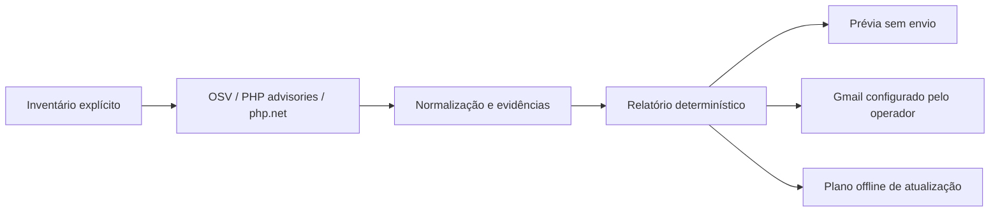

# CIBERIA Community

Triagem de vulnerabilidades com inventário explícito, fontes verificáveis e rastreabilidade. Um workflow em **n8n e JavaScript** correlaciona versões de pacotes **npm/Composer** e informações de **PHP** com advisories públicos. Scripts em **Node.js** coletam lockfiles e organizam planos offline de atualização.

A edição Community inclui somente código genérico e exemplos sintéticos. O fluxo vem **desativado**, com demonstração offline, `dryRun: true`, `useAI: false` e sem credenciais ou inventários reais.



## O que faz

- Consulta OSV para versões exatas de dependências npm e Packagist, incluindo transitivas presentes no inventário.
- Consulta advisories do PHP em `php/php-src` e comunicados do php.net.
- Diferencia dependência em repositório, informação declarada de runtime e cobertura incompleta.
- Agrupa notificações por ativo, pacote e advisory, com deduplicação e lembretes.
- Gera relatórios e candidatos de atualização offline com hashes SHA-256 das entradas.
- Pode enviar email pelo Gmail e usar Gemini para um comentário auxiliar. A classificação permanece determinística.

Correspondência de versão não comprova exploração. Um lockfile não comprova o conteúdo publicado em produção. Candidatos de atualização precisam de resolução pelo gerenciador de pacotes, testes e auditoria atualizada.

## Começar sem n8n, rede ou credenciais

Requisito: **Node.js 22 ou superior**. Os scripts não têm dependências npm externas; não é necessário executar `npm install`.

```sh
git clone https://github.com/DanielGoldoni/ciberia-community.git
cd ciberia-community
npm run check
node scripts/prepare-ciberia-repository-config.mjs --root examples/repository --id demo-app --project "Demo App" --output local/inventory.json
node scripts/build-ciberia-offline-report.mjs --input examples/offline-frame.json --output-dir local/report
```

Os dois últimos comandos usam somente arquivos fictícios incluídos neste repositório. As saídas ficam em `local/`, ignorado pelo Git. Consulte `--help` nos comandos para coletar seu próprio repositório explicitamente e conferir os hashes de um inventário.

## Importar no n8n

1. Importe [workflows/ciberia.json](workflows/ciberia.json) como **novo workflow**, sem publicá-lo ou ativá-lo.
2. Execute manualmente. A configuração padrão usa fixtures fictícias e percorre a rota offline até **Resultado sem envio**. Não consulta APIs, chama IA, envia emails ou grava deduplicação.
3. Consulte `previewHtml`, `findings` e `totals` na saída desse nó. Todos os advisories da demonstração usam identificadores `DEMO-*`.
4. Siga [docs/usage.md](docs/usage.md) para configurar um inventário privado e passar da demonstração à prévia com fontes reais.

O export é gerado por `npm run build:workflow`. IDs dos nós e conteúdo do arquivo são reproduzíveis. Os nós Gmail e Gemini vêm desabilitados e sem referências de credenciais; as instruções de uso explicam a habilitação explícita.

Uma instalação local opcional está em [compose.yaml](compose.yaml), limitada a `127.0.0.1:5679`. Veja o procedimento e os limites em [docs/usage.md](docs/usage.md).

## Tecnologias

**n8n · JavaScript · Node.js/ESM · Docker Compose · HTTP/JSON · OSV · GitHub Security Advisories · php.net · Gmail · Gemini opcional · node:test · node:vm · SHA-256**

## Validação desta edição

- **55 testes offline** de configuração, correlação, aliases, deduplicação, falhas de fonte, coleta e plano de atualização.
- Importação e execução em modo manual no **n8n 2.47.5**, em container descartável sem rede externa: oito nós locais, sete alertas fictícios `DEMO-*` e nenhum nó HTTP, Gmail ou Gemini executado.
- Export reproduzível e revisão com **Gitleaks 8.30.1**, sem segredos detectados nos arquivos e no histórico inicial.

O teste manual usou somente dados sintéticos. Credenciais reais, entrega de email e chamadas ao Gemini não foram exercitadas.

## Limites atuais

- O inventário é fornecido pelo operador; não há descoberta automática de servidores, contas cloud ou repositórios remotos.
- O escopo é npm, Packagist e PHP. Sistema operacional, imagens, configurações de serviços e autorização da aplicação exigem análises próprias.
- A comparação local de PHP e dos candidatos offline cobre faixas numéricas simples. Casos não suportados permanecem inconclusivos.
- As fontes podem falhar, limitar consultas ou mudar de formato. Cobertura parcial gera indicação explícita.
- A deduplicação usa static data do n8n, sem transação ou lock. Execute uma rodada de produção por vez; uma falha após o Gmail aceitar a mensagem pode causar repetição.
- O projeto não aplica patches, instala dependências, cria PRs, faz merges, deploys ou testes ofensivos.
- As integrações reais de Gmail e Gemini precisam ser validadas na instalação do operador.

## Documentação e contribuição

- [Uso e configuração](docs/usage.md)
- [Arquitetura e mapa de código](docs/architecture.md)
- [Privacidade e publicação de exemplos](docs/privacy.md)
- [Contribuição](CONTRIBUTING.md) e [relato de vulnerabilidades](SECURITY.md)

O código desta edição está sob [licença MIT](LICENSE). O n8n e os serviços externos têm licenças e termos próprios; veja [THIRD_PARTY_NOTICES.md](THIRD_PARTY_NOTICES.md).
